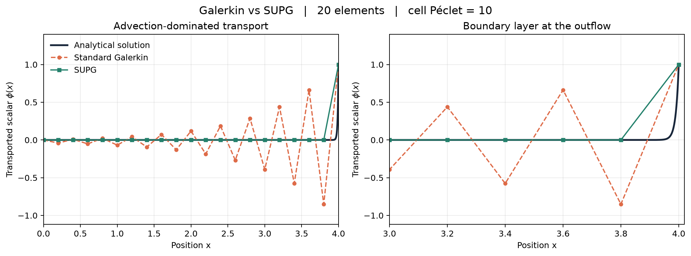
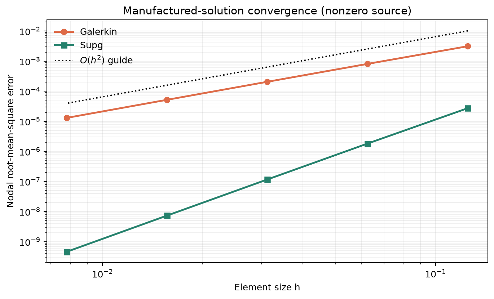

# Advection–Diffusion: Galerkin vs SUPG

**A reproducible Python implementation of one dimensional finite element
advection–diffusion, comparing standard Galerkin discretisation with
streamline upwind/Petrov–Galerkin (SUPG) stabilisation.**

I revisited my Computational Fluid Dynamics coursework and developed this
standalone Python project to examine why standard Galerkin finite elements can
produce nonphysical oscillations in advection-dominated regimes, and how
residual based streamline stabilisation changes the numerical solution.
Original MATLAB coursework scripts are archived under
[`legacy/coursework/`](legacy/coursework/). 

## Results

### Advection dominated boundary layer



For the original coursework parameters $L=4$, $u=1$,
$\varepsilon=0.01$, and **20 linear elements** (cell Péclet number 10),
the unstabilised Galerkin solution undershoots to **−0.852**. SUPG eliminates
the nodal oscillations and reproduces the analytical zero source solution
at the grid points to numerical precision.

**Caution:** the smooth black curve is the analytical solution and the green
line is a piecewise linear finite-element interpolant. SUPG is *nodally exact*
for this specific constant coefficient, zero source setup, but the sharp layer
is **not resolved between nodes** on this coarse mesh.

### Grid refinement with a nonzero source



With a smooth manufactured solution, both methods exhibit decreasing **nodal**
errors as the mesh is refined. For this particular experiment, observed
finest-grid rates are about **1.994 (Galerkin)** and **3.994 (SUPG nodal
error)**. The high SUPG nodal rate is specific to this example. See [verification details](docs/verification.md)
and [recorded errors](results/manufactured_convergence.csv).

## Mathematical model

$$
-\varepsilon\phi''(x) + u\phi'(x) = f(x), \quad 0<x<L,
\qquad \phi(0)=\phi_L, \quad \phi(L)=\phi_R.
$$

The Python solver uses **continuous, piecewise linear (P1) finite elements**
on a uniform one dimensional mesh, sparse matrix assembly, and SciPy's sparse
direct solver. The SUPG method includes a residual based stabilisation term,
including the corresponding **source term contribution**. The coefficient is
computed using the classical 1D cell-Péclet formula

$$
\mathrm{Pe}_h=\frac{|u|h}{2\varepsilon},\qquad
\tau=\frac{h}{2|u|}\left(\coth(\mathrm{Pe}_h)-\frac1{\mathrm{Pe}_h}\right).
$$

Numerical safeguards handle small Péclet numbers and steep analytical
boundary layers. The [method documentation](docs/method.md) derives the element
matrices and explains the scope of the nodal exactness result.

## Install and reproduce

Python 3.10+ is required, no MATLAB licence or external PDE solver is needed.

```bash
python3 -m venv .venv
source .venv/bin/activate
python -m pip install --upgrade pip
python -m pip install -e ".[dev]"
python -m pytest -q
python scripts/run_comparison.py
python scripts/run_refinement.py
```

The scripts regenerate `figures/galerkin_vs_supg.png`,
`figures/manufactured_convergence.png`, and
`results/manufactured_convergence.csv` deterministically. No datasets or
random number seeds are needed. To use the solver in Python:

```python
from advection_supg import solve, exact_homogeneous

result = solve(n=20, length=4.0, velocity=1.0, epsilon=0.01, method="supg")
reference = exact_homogeneous(result.x, length=4.0, velocity=1.0, epsilon=0.01)
print("Max nodal error:", abs(result.phi - reference).max())
```

## Numerical verification

The original 1D MATLAB stencil has been independently reconstructed in tests,
including its additional diffusion in the stabilised case. Other tests cover
linear and quadratic exact solutions, nonzero source terms, positive/negative
advection, small/large Péclet limits, and smooth-solution grid refinement.
CI status must be checked after
publication. See [verification and limitations](docs/verification.md).

## Repository layout

```text
src/advection_supg/       Sparse P1 FEM, SUPG, analytical solution
scripts/                  Plot generation and refinement experiment
tests/                    pytest numerical regression tests
figures/                  Regenerated, versioned numerical plots
results/                  Deterministic manufactured-solution error CSV
docs/                     Mathematical formulation and verification scope
legacy/coursework/        Original MATLAB scripts, preserved unchanged
.github/workflows/        Python test workflow
```

## Scope and provenance

This is a **1D steady transport model**, not a multidimensional CFD or
Navier–Stokes solver. The original MATLAB scripts were exploratory coursework:
`assignment1_3.m` uses a 1000 element **numerical Galerkin** solution labelled
`"Exact"`. The new Python comparison uses an actual analytical solution.
See [`legacy/README.md`](legacy/README.md).

This repository contains only numerical examples and coursework
algorithms, not confidential or clinical data. 

## Further reading

The SUPG parameter and nodal-exactness property are discussed in
[R. Codina (1998)](https://deca.upc.edu/en/people/ramon.codina/meflu/art-prac2.pdf).
The sparse linear solve uses [SciPy's `spsolve`](https://docs.scipy.org/doc/scipy/reference/generated/scipy.sparse.linalg.spsolve.html).
